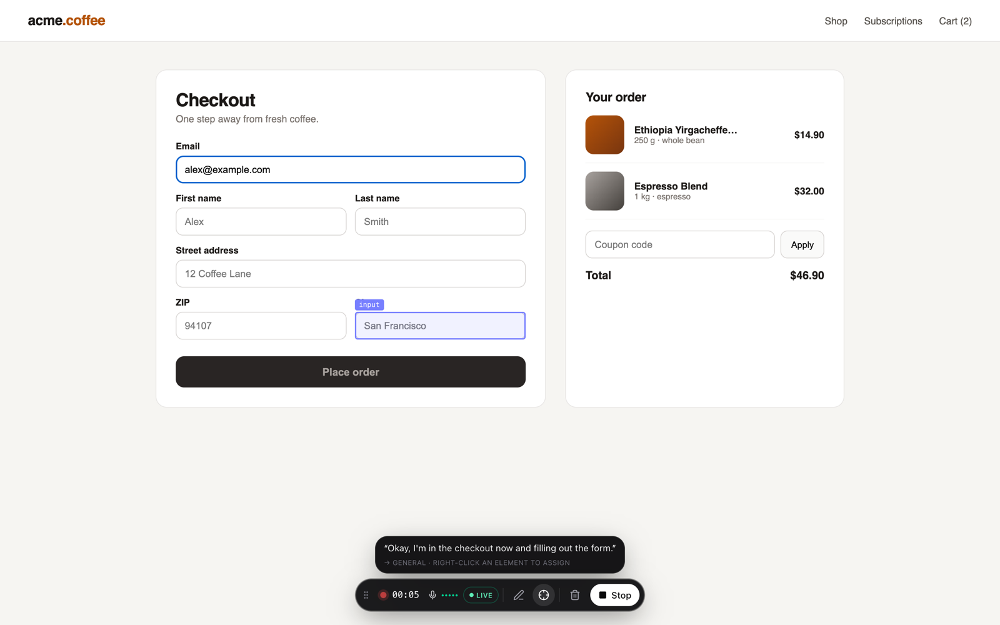
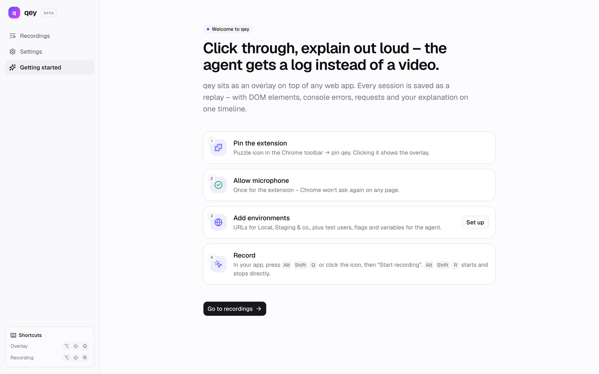
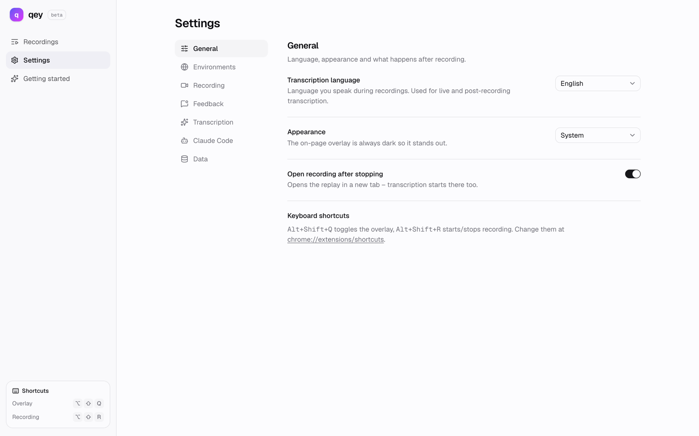

<div align="center">


# qey

**Click through a web app, say out loud what bugs you – and Claude Code gets structured
feedback instead of a video.**

Chrome extension · live transcript · session replay · MCP server for Claude Code

</div>


## The idea

Giving feedback on a website is tedious: take screenshots, draw arrows, write tickets, record
a Loom – and someone still has to guess *which* button you meant. For a coding agent, a video
is even more of a black box.

qey flips that around. You click through the page as usual and talk about what's good or bad
along the way. In the background the extension captures two things:

1. **What you do** – which element you point at, what you hover, click and type, what changes
   in the DOM as a result, which console errors and failed requests show up. Plus a full
   session replay.
2. **What you say** – via live transcription, on the same timeline.

When something catches your eye, **right-click the element**. It gets highlighted, a floating
bubble appears, and everything you say from then on streams into it live. Each of these
feedback points (F1, F2, …) becomes a precise finding: your comment, the selector, the
React/Vue component chain, computed styles, a DOM snippet, a screenshot and the errors from
that time window.

When you stop, everything goes to a local **MCP server**. Claude Code then fetches the
feedback itself – screenshots included, as images:

> Fix the latest qey feedback

## What it looks like

| Talking without a target → caption "general" | Pen: circle something → point with markup |
| --- | --- |
|  |  |

| All points with screenshots, selector and component | Replay with activity, speech, console and network |
| --- | --- |
|  |  |

And this is what Claude receives (excerpt from `qey_get_feedback`):

````markdown
## F1 · [00:16.5] button "Place order" – /

> "This button looks disabled even though you can click it. Grey text on a dark background is hard to read."

- **Element:** `[data-testid="place-order"]` · role `button` · name "Place order"
- **Component (react):** `CheckoutPage › CheckoutForm › SubmitButton`
- **Captured via:** right-click

**Steps before**
1. Page loaded: http://localhost:5199/
2. Click on textbox "you@example.com"
3. Input in textbox "you@example.com": "alex@example.com"

**Errors in this window**
- [00:21.4] POST http://localhost:5199/api/orders → **404** · 12 ms
- [00:21.4] console.error: Order failed: 404

**Computed styles**
```css
color: rgb(168, 162, 158);
background-color: rgb(41, 37, 36);
```
````

## Installation (without the Chrome Web Store)

qey isn't in the Chrome Web Store (yet). Chrome won't install extensions from outside the
store by double-click or drag & drop – the way in is **developer mode** and an unpacked
folder. It takes less than five minutes.

**Requirements:** Chrome (or another Chromium-based browser), [Node.js](https://nodejs.org) ≥ 22
and [pnpm](https://pnpm.io) 11 (`npm i -g pnpm`).

### 1. Build

```bash
git clone https://github.com/jannesrudnick/qey.git
cd qey
pnpm install
pnpm --filter qey-extension build
```

The result lands in `extension/.output/chrome-mv3`.

### 2. Load it in Chrome

1. Open `chrome://extensions`
2. Turn on **Developer mode** (top right)
3. **Load unpacked** → pick the `extension/.output/chrome-mv3` folder
4. **Pin** qey via the puzzle icon in the toolbar

The *Getting started* page opens. **Allow the microphone** there once – the permission applies
to the extension, not to each website.



> **Sharing with others:** `pnpm --filter qey-extension zip` creates
> `extension/.output/qey-extension-<version>-chrome.zip`. Recipients unzip it and load the
> unpacked folder as described above – no Node required.

> **Updating:** `git pull && pnpm install && pnpm --filter qey-extension build`, then click ↻ on
> qey in `chrome://extensions`. Don't move the folder: Chrome derives an unpacked extension's ID
> from its path, and your saved recordings are tied to that ID.

### 3. Connect Claude Code (optional)

`pnpm install` already built the MCP server. Once, from the repo root:

```bash
claude mcp add qey -- node "$(pwd)/mcp/dist/index.js"
```

While Claude Code is running, the server accepts recordings on `127.0.0.1:4777`. In the
extension, go to *Settings → Claude Code* and click **Test** – "Connected" means you're set.
From then on every recording is sent to Claude automatically when you stop. Details:
[`mcp/README.md`](mcp/README.md).

### 4. Live transcript (optional)

For the live bubbles qey needs an OpenAI API key (*Settings → Transcription*); the microphone
is then transcribed via the Realtime API. **Without a key** everything else works the same:
the audio is transcribed locally with Whisper in the browser after recording (one-time model
download, offline afterwards) and assigned to the points via the timeline.

Pick the language you speak under *Settings → General → Transcription language* (English,
German, French, Spanish).



## Usage


| | |
| --- | --- |
| Show/hide the dock | Click the qey icon or `Alt+Shift+Q` |
| Start/stop recording | Button in the dock or `Alt+Shift+R` |
| Feedback point | **Right-click** the element – whatever you said in the 10 seconds before is picked up |
| Finish a point | `Enter`, `Esc`, "Done" or simply the next right-click |
| Regular context menu | `Alt` + right-click |
| Mark something | **Pen** in the dock, draw on the page – the circled element becomes a point |
| Recordings, replay, settings | Buttons in the dock or right-click the qey icon |

Recording continues across page navigations. On console or network errors qey takes a
screenshot automatically.

In the settings you can define **environments** (URL patterns for local, staging, production –
with notes and variables such as test users). They're included in every handoff so the agent
knows where you tested. Values marked as secret are never exported.

## Development

```bash
pnpm install
pnpm --filter qey-extension dev         # launches Chrome with the extension loaded and hot reload
pnpm --filter qey-extension typecheck
pnpm --filter qey-extension build       # → extension/.output/chrome-mv3

pnpm --filter qey-mcp build
node mcp/scripts/smoke.mjs              # calls every MCP tool against the existing recordings

pnpm dev                                # landing page on http://localhost:3000
```

The extension is built with [WXT](https://wxt.dev), React 19, Tailwind v4 and shadcn/ui. For a
quick test any local app with a React or Vue dev build will do – then qey also shows the
component chain.

```
extension/  The Chrome extension (Manifest V3) – overlay, recorder, replay app, settings
mcp/        MCP server: receives handoffs over HTTP, exposes them to Claude Code as tools
src/app/    Landing page (Next.js, deployed on Vercel); uses the screenshots from extension/docs
```

Architecture, design decisions and gotchas in detail:
[`extension/README.md`](extension/README.md).

## Technical details

```
┌─ Tab ─────────────────────────────────────┐      ┌─ Service worker ───────────────┐
│ Content script (isolated world)           │ Port │ State, shortcuts, context menu │
│  · Overlay in a shadow root               │─────▶│ writes chunks to IndexedDB     │
│  · rrweb (replay) + semantic recorder     │      │ captureVisibleTab (screenshots)│
│  · Feedback points, pen                   │◀─────│                                │
│ MAIN-world script (only while recording)  │ live └──────┬─────────────────────────┘
│  · console, fetch/XHR, history,           │             │
│    React fiber / Vue instance             │      ┌──────▼─────────────────────────┐
└───────────────────────────────────────────┘      │ Offscreen document             │
                                                   │ Microphone → MediaRecorder     │
┌─ Extension app ───────────────────────────┐      │ PCM16 → OpenAI Realtime (WS)   │
│ Recordings · Replay · Whisper (WASM/WebGPU)│     └────────────────────────────────┘
│ Handoff: Markdown + JSON + screenshots    │
└──────────────┬────────────────────────────┘
               │ POST /sessions
        ┌──────▼──────────────┐   stdio/MCP   ┌─────────────┐
        │ qey MCP 127.0.0.1   │──────────────▶│ Claude Code │
        │ ~/.qey/sessions/    │               └─────────────┘
        └─────────────────────┘
```

**Two tracks instead of one video.** rrweb records the DOM for the replay. In parallel, a
semantic recorder writes for agents: hovers after 400 ms dwell, clicks, input (passwords
masked), navigation, scrolling – each element with a stable selector (preferring
`data-testid`, `id`, `aria-label`), role and accessible name. After every click it briefly
watches the DOM and attaches the **effect**: new nodes, opened dialogs, messages, URL changes.

**Feedback points.** A right-click creates a point at the element under the cursor. It comes
with a screenshot (qey's own UI is hidden for the capture), the component chain from the React
fiber or Vue instance (including the source file when the dev build provides it), the relevant
computed styles (including a hint about clipped content), a DOM snippet around the element and
the steps before.

**Assigning speech.** Live sentences belong to the currently open point. Sentences that don't
belong to a point yet are kept for ten seconds – if you talk first and right-click afterwards,
nothing is lost. Without a live transcript, qey assigns the segments after recording based on
each point's active time.

**Robust recording.** Every track is written to IndexedDB in one-second chunks. If the service
worker or the browser crashes, at most the last second is missing. The microphone runs in an
offscreen document so Chrome doesn't ask for permission on every page you test. `console` and
`fetch` are only patched while recording – otherwise the page stays untouched.

**Handoff.** After stopping, the extension builds a package of `feedback.md`, `handoff.json`,
screenshots and DOM snippets and sends it to the MCP server. The server stores it under
`~/.qey/sessions/` and offers Claude the tools `qey_list_sessions`, `qey_get_session`,
`qey_get_feedback`, `qey_get_screenshot` and `qey_get_logs`. Alternatively you can download
the package as a ZIP or copy the Markdown to the clipboard.

### Privacy & permissions

Recordings stay local in the extension's IndexedDB. Audio only leaves your machine if you add
an OpenAI key. The MCP server listens on `127.0.0.1` only and accepts requests from
`chrome-extension://` origins only.

| Permission | Used for |
| --- | --- |
| `<all_urls>`, `scripting` | The dock and recorder on the page you're testing |
| `tabs` | Screenshots of the visible tab, recording across navigations |
| `offscreen` | Microphone without every website needing its own permission |
| `storage`, `unlimitedStorage` | Storing recordings, replay and audio locally |
| `contextMenus` | "Open recordings" / "Settings" on the qey icon |

## Status & contributing

qey is early but usable: tested in Chrome. Ideas for what's next – issues and pull requests
are welcome:

- **Firefox** – there's no offscreen API there, so audio needs a different approach
- **Chrome Web Store** – install without developer mode
- **Sharing** – upload recordings and create an issue or agent task straight from them
- **Cross-origin iframes** in the replay
- Handoff to other agents besides Claude Code (MCP is an open protocol)
- Localized UI
