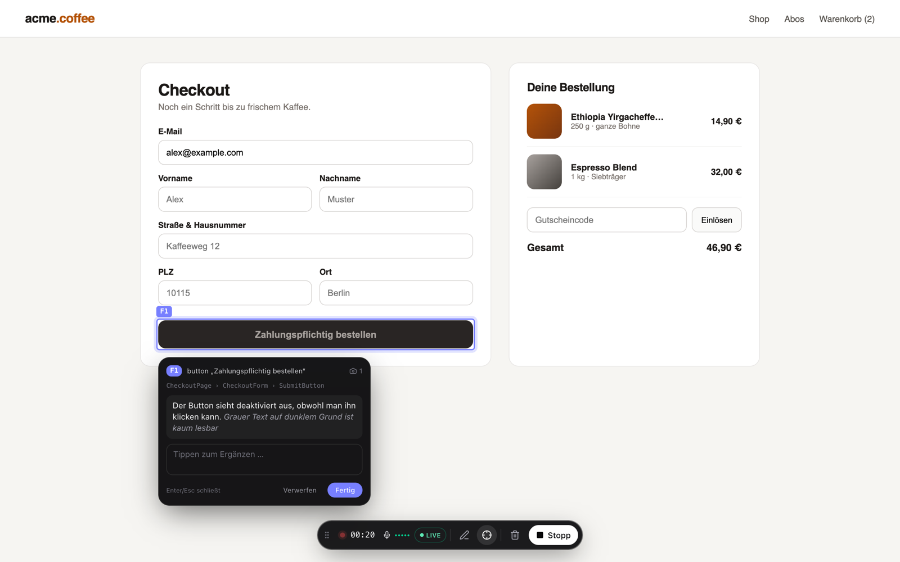
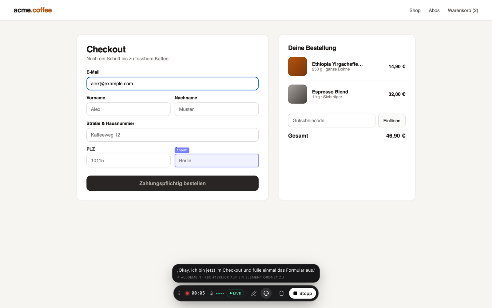
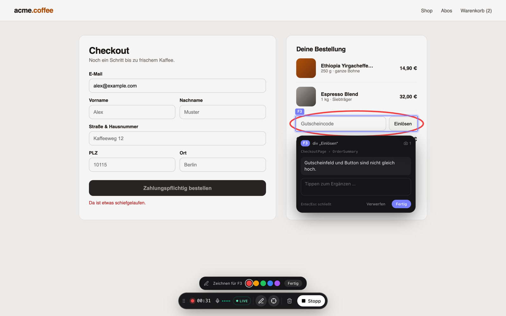
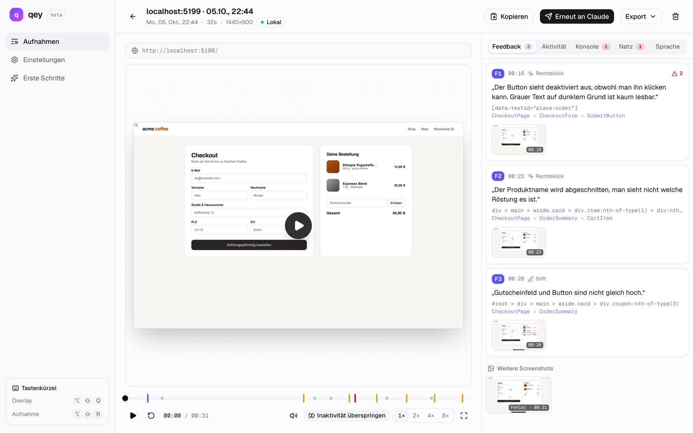
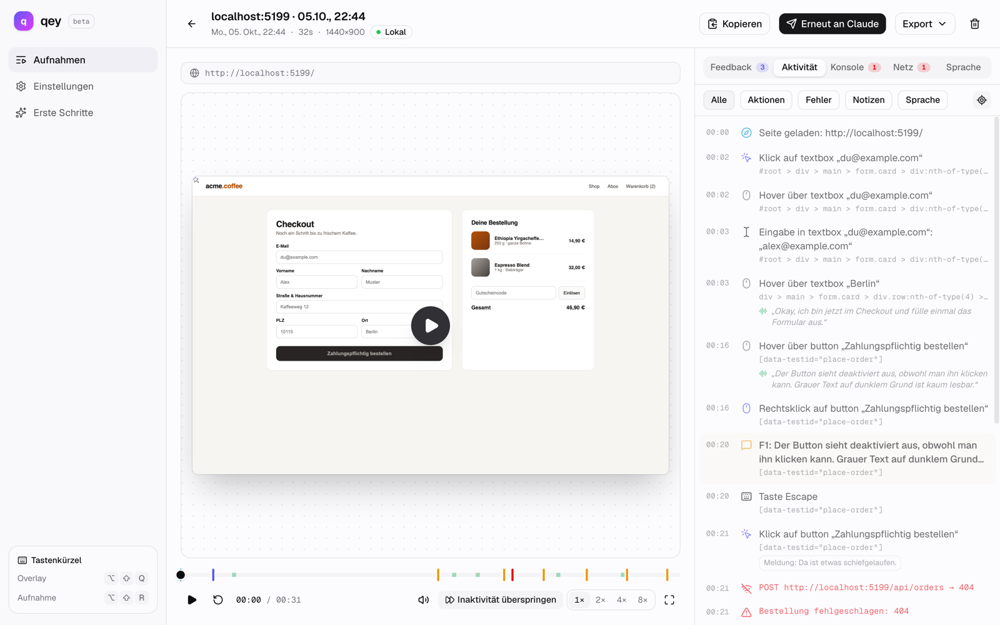
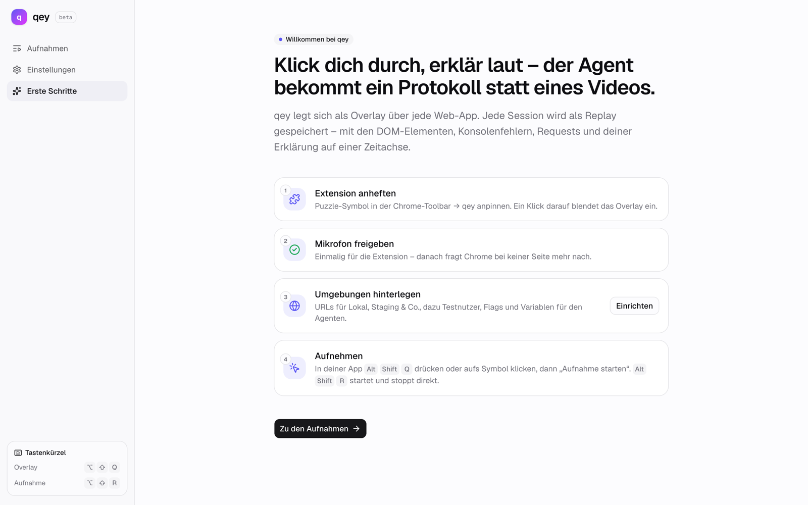
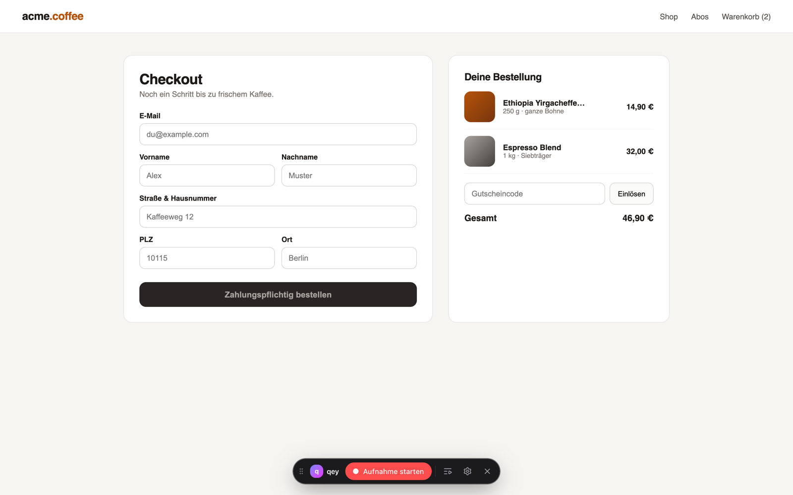

<div align="center">


# qey

**Klick dich durch eine Web-App, sag laut, was dich stört – und Claude Code bekommt
strukturiertes Feedback statt eines Videos.**

Chrome-Extension · Live-Transkript · Session-Replay · MCP-Server für Claude Code

</div>



## Die Idee

Feedback zu einer Website zu geben ist mühsam: Screenshots machen, Pfeile malen, Tickets
schreiben, ein Loom aufnehmen – und am Ende muss trotzdem jemand raten, *welcher* Button
gemeint war. Für einen Coding-Agenten ist ein Video erst recht eine Blackbox.

qey dreht das um. Du klickst dich ganz normal durch die Seite und erzählst nebenbei, was
gut oder schlecht ist. Die Extension schreibt im Hintergrund zwei Dinge mit:

1. **Was du tust** – auf welches Element du zeigst, worüber du hoverst, was du klickst und
   eintippst, was sich danach im DOM ändert, welche Konsolenfehler und fehlgeschlagenen
   Requests auftauchen. Dazu ein vollständiges Session-Replay.
2. **Was du sagst** – per Live-Transkription, auf derselben Zeitachse.

Wenn dir etwas auffällt, machst du einen **Rechtsklick auf das Element**. Es wird markiert,
eine schwebende Sprechblase erscheint, und alles, was du ab jetzt sagst, landet live darin.
Aus jedem dieser Feedback-Punkte (F1, F2, …) wird ein präziser Befund: deine Aussage, der
Selektor, die React-/Vue-Komponentenkette, berechnete Styles, ein DOM-Ausschnitt, ein
Screenshot und die Fehler aus dem Zeitfenster.

Nach dem Stoppen geht das Ganze an einen lokalen **MCP-Server**. Claude Code holt sich das
Feedback dann selbst – inklusive Screenshots als Bilder:

> Fix das letzte qey-Feedback

## So sieht das aus

| Reden ohne Ziel → Untertitel „allgemein“ | Stift: umkreisen → Punkt mit Markierung |
| --- | --- |
|  |  |

| Alle Punkte mit Screenshots, Selektor und Komponente | Replay mit Aktivität, Sprache, Konsole und Netz |
| --- | --- |
|  |  |

Und das kommt bei Claude an (Ausschnitt aus `qey_get_feedback`):

````markdown
## F1 · [00:16.5] button "Zahlungspflichtig bestellen" – /

> „Der Button sieht deaktiviert aus, obwohl man ihn klicken kann. Grauer Text auf dunklem Grund ist kaum lesbar.“

- **Element:** `[data-testid="place-order"]` · Rolle `button` · Name „Zahlungspflichtig bestellen“
- **Komponente (react):** `CheckoutPage › CheckoutForm › SubmitButton`
- **Erfasst über:** Rechtsklick

**Schritte davor**
1. Seite geladen: http://localhost:5199/
2. Klick auf textbox „du@example.com“
3. Eingabe in textbox „du@example.com“: „alex@example.com“

**Fehler im Zeitraum**
- [00:21.3] POST http://localhost:5199/api/orders → **404** · 10 ms
- [00:21.3] console.error: Bestellung fehlgeschlagen: 404

**Berechnete Styles**
```css
color: rgb(168, 162, 158);
background-color: rgb(41, 37, 36);
```
````

## Installation (ohne Chrome Web Store)

qey ist (noch) nicht im Chrome Web Store. Chrome installiert Extensions von außerhalb des
Stores nicht per Doppelklick oder Drag & Drop – der Weg führt über den **Entwicklermodus**
und einen entpackten Ordner. Das dauert keine fünf Minuten.

**Voraussetzungen:** Chrome (oder ein anderer Chromium-Browser), [Node.js](https://nodejs.org) ≥ 22
und [pnpm](https://pnpm.io) 11 (`npm i -g pnpm`).

### 1. Bauen

```bash
git clone https://github.com/jannesrudnick/qey.git
cd qey
pnpm install
pnpm --filter qey-extension build
```

Das Ergebnis liegt in `extension/.output/chrome-mv3`.

### 2. In Chrome laden

1. `chrome://extensions` öffnen
2. Oben rechts den **Entwicklermodus** einschalten
3. **Entpackte Erweiterung laden** → den Ordner `extension/.output/chrome-mv3` wählen
4. Über das Puzzle-Symbol in der Toolbar qey **anpinnen**

Es öffnet sich die Seite *Erste Schritte*. Dort einmal das **Mikrofon freigeben** – die
Freigabe gilt für die Extension, nicht pro Website.



> **An andere weitergeben:** `pnpm --filter qey-extension zip` erzeugt
> `extension/.output/qey-extension-<version>-chrome.zip`. Empfänger entpacken die ZIP und laden
> den entpackten Ordner wie oben beschrieben – Node ist dafür nicht nötig.

> **Aktualisieren:** `git pull && pnpm install && pnpm --filter qey-extension build`, dann auf
> `chrome://extensions` bei qey auf ↻ klicken. Den Ordner dabei nicht verschieben: Chrome leitet
> die ID einer entpackten Extension aus ihrem Pfad ab, und an der ID hängen die gespeicherten
> Aufnahmen.

### 3. Claude Code verbinden (optional)

Der MCP-Server wurde von `pnpm install` schon gebaut. Im Repo-Root einmalig:

```bash
claude mcp add qey -- node "$(pwd)/mcp/dist/index.js"
```

Solange Claude Code läuft, nimmt der Server auf `127.0.0.1:4777` Aufnahmen entgegen. In der
Extension unter *Einstellungen → Claude Code* auf **Testen** klicken – „Verbunden“ heißt, es
klappt. Ab jetzt geht jede Aufnahme nach dem Stoppen automatisch an Claude. Details:
[`mcp/README.md`](mcp/README.md).

### 4. Live-Transkript (optional)

Für die Live-Sprechblasen braucht qey einen OpenAI-API-Key (*Einstellungen → Transkription*);
das Mikrofon wird dann per Realtime-API transkribiert. **Ohne Key** funktioniert alles andere
genauso: Die Tonspur wird nach der Aufnahme lokal mit Whisper im Browser transkribiert (einmaliger
Modell-Download, danach offline) und das Gesagte über die Zeitachse den Punkten zugeordnet.

## Bedienung



| | |
| --- | --- |
| Leiste ein-/ausblenden | Klick aufs qey-Symbol oder `Alt+Shift+Q` |
| Aufnahme starten/stoppen | Button in der Leiste oder `Alt+Shift+R` |
| Feedback-Punkt | **Rechtsklick** aufs Element – was du in den 10 Sekunden davor gesagt hast, wird mitgenommen |
| Punkt abschließen | `Enter`, `Esc`, „Fertig“ oder einfach der nächste Rechtsklick |
| Normales Kontextmenü | `Alt` + Rechtsklick |
| Markieren | **Stift** in der Leiste, auf der Seite zeichnen – das umkreiste Element wird zum Punkt |
| Aufnahmen, Replay, Einstellungen | Buttons in der Leiste oder Rechtsklick aufs qey-Symbol |

Die Aufnahme läuft über Seitenwechsel hinweg weiter. Bei Konsolen- oder Netzwerkfehlern macht
qey automatisch einen Screenshot.

In den Einstellungen lassen sich **Umgebungen** hinterlegen (URL-Muster für Lokal, Staging,
Produktion – mit Notizen und Variablen wie Testnutzern). Sie landen im Kontext jedes Handoffs,
damit der Agent weiß, wo getestet wurde. Als geheim markierte Werte werden nie exportiert.

## Entwicklung

```bash
pnpm install
pnpm --filter qey-extension dev         # startet Chrome mit geladener Extension und Hot Reload
pnpm --filter qey-extension typecheck
pnpm --filter qey-extension build       # → extension/.output/chrome-mv3

pnpm --filter qey-mcp build
node mcp/scripts/smoke.mjs              # ruft alle MCP-Tools gegen die vorhandenen Aufnahmen auf
```

Die Extension ist mit [WXT](https://wxt.dev), React 19, Tailwind v4 und shadcn/ui gebaut.
Für einen schnellen Test reicht eine beliebige lokale App mit React- oder Vue-Dev-Build –
dann zeigt qey auch die Komponentenkette.

```
extension/   Die Chrome-Extension (Manifest V3) – Overlay, Recorder, Replay-App, Einstellungen
mcp/         MCP-Server: nimmt Handoffs per HTTP an, stellt sie Claude Code als Tools bereit
src/lib/qa/  Datenmodell, Sprache↔Event-Korrelation und Markdown-Export (von der Extension
             als @shared importiert)
src/, public/  Der Vorgänger: QA-Recorder als Next.js-Web-App mit iframe-Proxy (docs/web-app.md)
```

Architektur, Designentscheidungen und Stolpersteine im Detail:
[`extension/README.md`](extension/README.md).

## Technische Details

```
┌─ Tab ─────────────────────────────────────┐      ┌─ Service Worker ───────────────┐
│ Content-Script (isolierte Welt)           │ Port │ Zustand, Kürzel, Kontextmenü   │
│  · Overlay im Shadow Root                 │─────▶│ schreibt Chunks nach IndexedDB │
│  · rrweb (Replay) + semantischer Recorder │      │ captureVisibleTab (Screenshots)│
│  · Feedback-Punkte, Stift                 │◀─────│                                │
│ MAIN-World-Script (nur während Aufnahme)  │ live └──────┬─────────────────────────┘
│  · console, fetch/XHR, history,           │             │
│    React-Fiber / Vue-Instanz              │      ┌──────▼─────────────────────────┐
└───────────────────────────────────────────┘      │ Offscreen-Dokument             │
                                                   │ Mikrofon → MediaRecorder       │
┌─ Extension-App ───────────────────────────┐      │ PCM16 → OpenAI Realtime (WS)   │
│ Aufnahmen · Replay · Whisper (WASM/WebGPU)│      └────────────────────────────────┘
│ Handoff: Markdown + JSON + Screenshots    │
└──────────────┬────────────────────────────┘
               │ POST /sessions
        ┌──────▼──────────────┐   stdio/MCP   ┌─────────────┐
        │ qey-MCP 127.0.0.1   │──────────────▶│ Claude Code │
        │ ~/.qey/sessions/    │               └─────────────┘
        └─────────────────────┘
```

**Zwei Spuren statt einem Video.** rrweb zeichnet das DOM für das Replay auf. Parallel läuft
ein semantischer Recorder, der für Agenten schreibt: Hover ab 400 ms Verweildauer, Klicks,
Eingaben (Passwörter maskiert), Navigation, Scrollen – jedes Element mit stabilem Selektor
(bevorzugt `data-testid`, `id`, `aria-label`), Rolle und Accessible Name. Nach jedem Klick
beobachtet er das DOM kurz und hängt die **Wirkung** an: neue Knoten, geöffnete Dialoge,
Meldungen, URL-Wechsel.

**Feedback-Punkte.** Ein Rechtsklick erzeugt einen Punkt am Element unter dem Cursor. Dazu
gehören ein Screenshot (die eigene Oberfläche wird dafür kurz ausgeblendet), die
Komponentenkette aus dem React-Fiber bzw. der Vue-Instanz (inklusive Quelldatei, wenn der
Dev-Build sie mitliefert), die relevanten berechneten Styles (inklusive Hinweis auf
abgeschnittenen Inhalt), ein DOM-Ausschnitt um das Element und die Schritte davor.

**Sprache zuordnen.** Live-Sätze gehören zum gerade offenen Punkt. Sätze, die noch keinem Punkt
gehören, merkt sich qey zehn Sekunden lang – wer erst redet und dann rechtsklickt, verliert
nichts. Ohne Live-Transkript ordnet qey die Abschnitte nach der Aufnahme über die Aktivzeit
der Punkte zu.

**Robust aufnehmen.** Jede Spur wird sekundenweise als Chunk nach IndexedDB geschrieben.
Stürzt der Service Worker oder der Browser ab, fehlt höchstens die letzte Sekunde. Das
Mikrofon läuft in einem Offscreen-Dokument, damit Chrome die Freigabe nicht für jede getestete
Seite einzeln abfragt. `console` und `fetch` werden nur während einer Aufnahme gepatcht –
außerhalb bleibt die Seite unangetastet.

**Handoff.** Nach dem Stoppen baut die Extension ein Paket aus `feedback.md`, `handoff.json`,
Screenshots und DOM-Ausschnitten und schickt es an den MCP-Server. Der legt es unter
`~/.qey/sessions/` ab und bietet Claude die Tools `qey_list_sessions`, `qey_get_session`,
`qey_get_feedback`, `qey_get_screenshot` und `qey_get_logs`. Alternativ gibt es das Paket als
ZIP oder das Markdown in der Zwischenablage.

### Datenschutz & Berechtigungen

Aufnahmen bleiben lokal in der IndexedDB der Extension. Audio verlässt den Rechner nur, wenn du
einen OpenAI-Key hinterlegst. Der MCP-Server lauscht ausschließlich auf `127.0.0.1` und nimmt
nur Anfragen von `chrome-extension://`-Origins an.

| Berechtigung | Wofür |
| --- | --- |
| `<all_urls>`, `scripting` | Leiste und Recorder auf der Seite, die du testest |
| `tabs` | Screenshots des sichtbaren Tabs, Aufnahme über Seitenwechsel |
| `offscreen` | Mikrofon, ohne dass jede Website eine eigene Freigabe braucht |
| `storage`, `unlimitedStorage` | Aufnahmen, Replay und Audio lokal speichern |
| `contextMenus` | „Aufnahmen öffnen“ / „Einstellungen“ am qey-Symbol |

## Status & Mitmachen

qey ist ein früher, aber benutzbarer Stand: getestet in Chrome, Oberfläche auf Deutsch. Ideen
für die nächsten Schritte – Issues und Pull Requests sind willkommen:

- **Firefox** – dort gibt es kein Offscreen-API, Audio muss anders gelöst werden
- **Englische Oberfläche** und weitere Sprachen
- **Chrome Web Store** – Installation ohne Entwicklermodus
- **Teilen** – Aufnahmen hochladen und direkt als Issue oder Agent-Task anlegen
- **Cross-Origin-iframes** im Replay
- Handoff an weitere Agenten neben Claude Code (das MCP-Protokoll ist offen)
