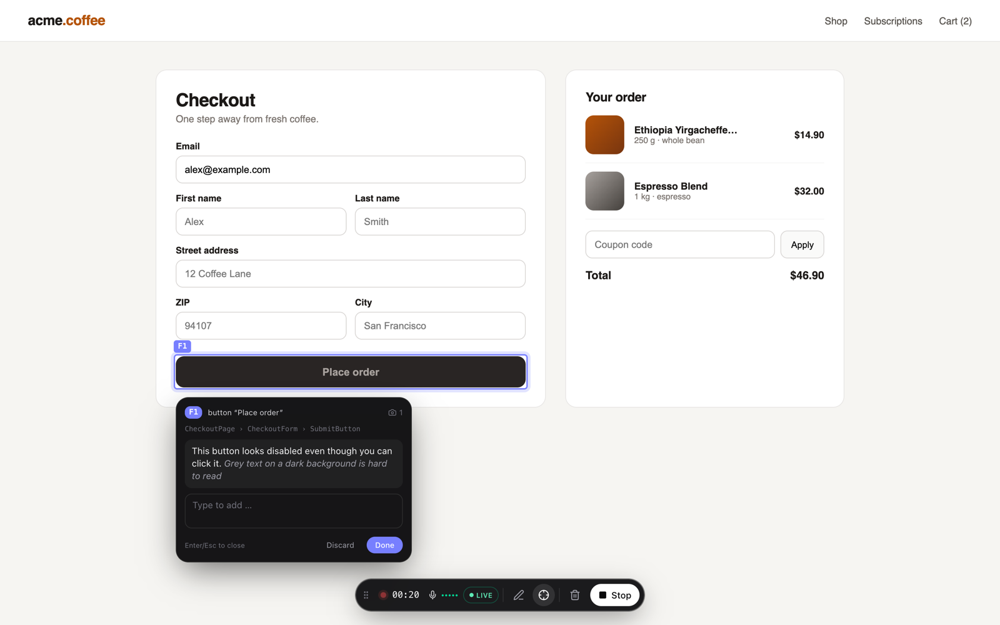
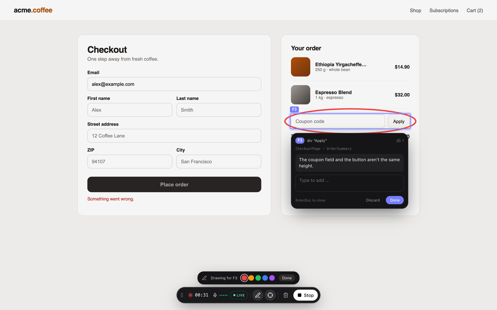
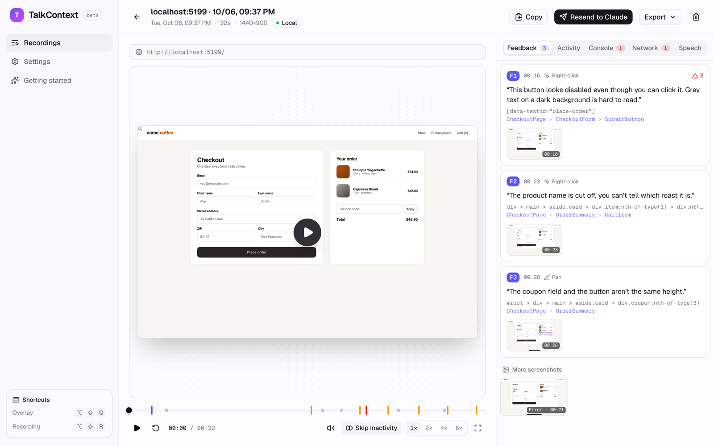
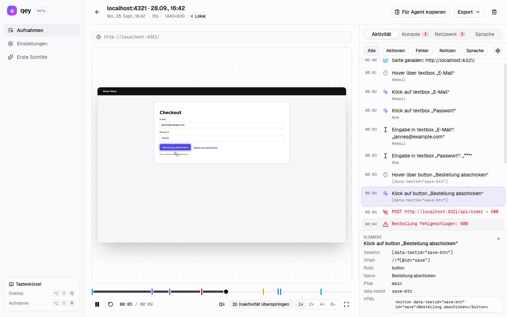

# TalkContext – browser extension

The QA recorder as a Chrome extension (Manifest V3). No script in the target app, no proxy, no
iframe: TalkContext sits as an overlay on top of the tab, you click through and explain out loud – it
records a **session replay (rrweb)**, the **semantic DOM log** for agents, **console**,
**network** and the **audio track**.

Overview, installation without the Web Store and Claude Code setup: [root README](../README.md).
This page goes deeper into usage, architecture and gotchas.

```
Toolbar icon / Alt+Shift+Q  →  overlay  →  Start recording  →  click through & talk
      Right-click an element / pen  →  feedback point (F1, F2 …) with speech, screenshot, context
                                                                                  ↓ Stop
      Replay like PostHog/Sentry + feedback tab  →  "Send to Claude"  →  Claude Code (TalkContext MCP)
```

| Right-click → feedback point with live transcript | Pen: circle → screenshot with markup |
| --- | --- |
|  |  |

| Feedback tab with screenshots | Replay with activity & element inspector |
| --- | --- |
|  |  |

## Feedback points

The core of the handoff: explicit findings instead of a timeline the agent has to guess from.

| How | What happens |
| --- | --- |
| **Right-click** an element (while recording) | New point, the element stays highlighted, a bubble shows live what's being captured. Everything said and typed belongs to this point until Enter/Esc, "Done" or the next right-click. Whatever was said in the 10 seconds before and doesn't belong to a point yet is picked up. Alt+right-click = regular context menu. |
| **Pen** in the dock | Draw on the page. After each stroke (or group of strokes) a screenshot with the markup is taken; the circled element is detected and becomes the point. |

On console/network errors an additional screenshot is taken automatically.

Every point gets: a timestamped screenshot (dock hidden, markup visible),
selector/XPath/role/name, the **component chain** from React or Vue dev builds (incl. source
file when available), computed styles (incl. a hint about clipped content), a DOM snippet with
the target marked, the steps before and the errors in its time window.

## Live transcript (OpenAI Realtime)

With an OpenAI API key (Settings → Transcription) the offscreen document streams the microphone
as PCM16/24 kHz over WebSocket to `wss://api.openai.com/v1/realtime?intent=transcription`. The
overlay shows interim results live – in the active point's bubble or as a caption above the
dock ("→ general"). The finished segments become the transcript directly at the end; no
re-transcription needed. Live is always on once the provider has a key. Without one (or if the
connection fails) the audio is transcribed right after stopping – with OpenAI if an OpenAI key
is set, otherwise locally with Whisper – and speech is assigned to points via their active time.

Alternatively, pick **Soniox** as the provider (Settings → Transcription): same live behaviour,
about 3x cheaper (~$0.12/h of streamed audio), key from console.soniox.com.

The spoken language is set under Settings → General → Transcription language.

## Handoff to Claude Code

"Send to Claude" (or automatically after stopping) sends the recording to the local
[TalkContext MCP server](../mcp/README.md). Claude Code then reads it via tools – screenshots included
as real images. Alternatively:

- **Handoff package (.zip)**: `feedback.md`, `handoff.json`, `session.json`, `screenshots/`, `dom/`
- **Copy**: just the Markdown (without images) to the clipboard

## Sharing recordings with teammates

**Export → Share recording (.talkcontext)** packs the whole recording – replay, audio, transcript,
feedback points, screenshots, console and network – into one file (a ZIP with `recording.json`,
`audio.*` and `screenshots/`). The other person clicks **Import** on the Recordings page and gets
it as a regular recording, marked "Imported". Imported recordings get a new id, are never sent
to Claude or transcribed automatically, and can be handed off from there like your own.

## Development

Requires **Node ≥ 22** (WXT uses `util.parseEnv`), see `.nvmrc` – e.g. `nvm use` or `fnm use`.

```bash
pnpm install            # in the repo root or here – the package is part of the pnpm workspace
pnpm --filter talkcontext-extension dev     # launches Chrome with the extension loaded (HMR)
pnpm --filter talkcontext-extension build   # → extension/.output/chrome-mv3
pnpm --filter talkcontext-extension typecheck
```

Load manually: `chrome://extensions` → Developer mode → "Load unpacked" →
`extension/.output/chrome-mv3`.

## Usage

| | |
| --- | --- |
| Overlay on/off | Click the toolbar icon or `Alt+Shift+Q` |
| Start/stop recording | Button in the overlay or `Alt+Shift+R` |
| Feedback point | Right-click the element or use the pen |
| Exit pen / finish point | `Esc` |
| Recordings & settings | Right-click the icon, or buttons in the overlay |

Recording continues across page navigations (the content script checks in with the background
after every load and resumes replay and log).

## Pages

- **Recordings** – list with search and environment filter.
- **Replay** – rrweb player with a timeline (markers for clicks, errors, notes, navigation,
  speech), speed, "Skip inactivity", synced audio. On the right: feedback points, activity
  (incl. assigned speech and an element inspector that highlights in the replay), console,
  network, speech. At the top: "Copy" (Markdown), "Send to Claude", export (handoff ZIP,
  Markdown, JSON, replay, audio track).
- **Settings** – transcription language/theme, **environments** (URL patterns, notes for the
  agent, variables; secret values are never exported), recording (microphone permission, log,
  replay masking), feedback (right-click, screenshot on errors, pen color), transcription
  (local Whisper or OpenAI, live transcript), Claude Code (endpoint, send automatically), data.

## Architecture

```
src/entrypoints/
  background.ts          State (storage.session), tab ports, writing to IndexedDB,
                         offscreen control, toolbar/shortcuts/context menu
  content/               Runs in every tab (isolated world)
    index.tsx            Bootstrap, shadow-root overlay (WXT createShadowRootUi)
    controller.ts        rrweb + semantic recorder, buffers and sends chunks over a port
    feedback.ts          Feedback points: right-click, pen, live speech, screenshots,
                         components/styles/DOM
    overlay.tsx          The floating dock (React, Tailwind in px instead of rem)
  main-world.ts          Only injected into the page while recording:
                         console, fetch/XHR (bodies on errors), history, component chain
                         (React fiber / Vue instance) → postMessage
  offscreen/             Microphone (MediaRecorder) + level, writes audio chunks to IndexedDB;
                         live-transcriber.ts streams to OpenAI Realtime in parallel
  options/               The app: recordings, replay, settings, getting started
src/lib/
  qa/                    Data model of the semantic log, speech↔event correlation, Markdown/JSON export
  recorder/              Semantic recorder: hover, click, input, navigation, DOM effects
  db.ts                  IndexedDB: recordings + chunks (rrweb, events, effects, cursor,
                         console, network, audio)
  transcription/         Whisper worker (transformers.js) and OpenAI
  handoff/               Build the handoff (Markdown, handoff.json, screenshots, DOM) + ZIP/MCP transport
src/features/            The app's pages
```

### Why it's built this way

- **Offscreen document for the microphone**: in the content script Chrome would ask for
  permission on every tested page separately, and the service worker has no `getUserMedia`. The
  permission is requested once on an extension page (Getting started / Settings).
- **MAIN-world script only while recording**: patching `console`/`fetch` changes the page's
  stack traces – outside a recording the page stays untouched.
- **Chunks instead of one big object**: every track is written second by second. If the service
  worker or the browser dies, at most the last second is missing.
- **Overlay in a shadow root**, excluded from the replay (`blockSelector`) and the log.

### Gotchas

- rrweb bundles postcss, which contains a literal U+FFFE. Chrome rejects content scripts with
  Unicode noncharacters ("isn't UTF-8 encoded") – `wxt.config.ts` escapes them after the build.
- Tailwind v4 initializes `--tw-*` via `@property`; that doesn't apply inside shadow DOM.
  `overlay.css` sets the defaults itself.
- Chrome injects its own unlayered font defaults into extension pages; `globals.css` therefore
  sets the font unlayered.
- Chrome injects the same defaults (`font-size: 75%`) into the replay iframe – without a reset
  the replay would be smaller than the original and pen markup would be off (`player.tsx`).
- The ONNX runtime for Whisper is copied from `node_modules` to `public/ort/` (not in the
  repo, `scripts/copy-ort-runtime.mjs`).

## Open / next steps

- Firefox (no offscreen API → audio needs a different approach)
- Share/upload recordings (backend) and create an issue/agent task directly
- Cross-origin iframes in the replay (`recordCrossOriginIframes`)
