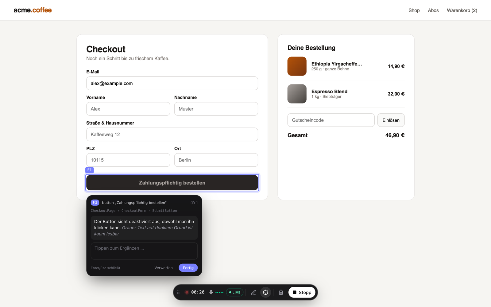
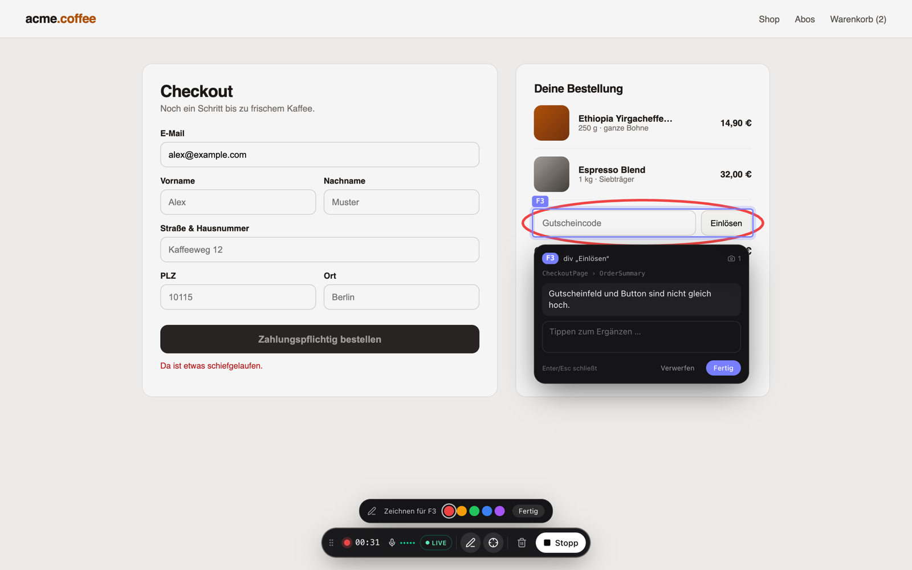

# qey – Browser-Extension

QA-Recorder als Chrome-Extension (Manifest V3). Kein Skript in der Zielanwendung, kein
Proxy, kein iframe: qey legt sich als Overlay über den Tab, du klickst dich durch und
erklärst laut – aufgezeichnet werden **Session-Replay (rrweb)**, das **semantische
DOM-Protokoll** für Agenten, **Konsole**, **Netzwerk** und die **Tonspur**.

Überblick, Installation ohne Web Store und Einrichtung von Claude Code: [README im Repo-Root](../README.md).
Diese Seite geht tiefer in Bedienung, Architektur und Stolpersteine.

```
Toolbar-Symbol / Alt+Shift+Q  →  Overlay  →  Aufnahme starten  →  durchklicken & reden
        Rechtsklick aufs Element / Stift  →  Feedback-Punkt (F1, F2 …) mit Sprache, Screenshot, Kontext
                                                                                    ↓ Stopp
      Replay wie PostHog/Sentry + Feedback-Tab  →  „An Claude senden“  →  Claude Code (qey-MCP)
```

| Rechtsklick → Feedback-Punkt mit Live-Transkript | Stift: umkreisen → Screenshot mit Markierung |
| --- | --- |
|  |  |

| Feedback-Tab mit Screenshots | Replay mit Aktivität & Element-Inspektor |
| --- | --- |
|  |  |

## Feedback-Punkte

Der Kern des Handoffs: ausdrückliche Befunde statt einer Timeline, aus der der Agent raten muss.

| Wie | Was passiert |
| --- | --- |
| **Rechtsklick** auf ein Element (während der Aufnahme) | Neuer Punkt, Element bleibt markiert, Sprechblase zeigt live, was festgehalten wird. Alles Gesagte und Getippte gehört zu diesem Punkt, bis Enter/Esc, „Fertig“ oder der nächste Rechtsklick. Was in den 10 Sekunden davor gesagt wurde und noch keinem Punkt gehört, wird übernommen. Alt+Rechtsklick = normales Kontextmenü. |
| **Stift** in der Leiste | Auf der Seite zeichnen. Nach jedem Strich (bzw. einer Gruppe von Strichen) entsteht ein Screenshot mit Markierung; das umkreiste Element wird erkannt und zum Punkt. |

Bei Konsolen-/Netzwerkfehlern entsteht automatisch ein zusätzlicher Screenshot.

Jeder Punkt bekommt: Screenshot mit Zeitstempel (Bedienleiste ausgeblendet, Markierungen
sichtbar), Selektor/XPath/Rolle/Name, **Komponentenkette** aus React- oder Vue-Dev-Builds
(inkl. Quelldatei, wenn verfügbar), berechnete Styles (inkl. Hinweis auf abgeschnittenen Inhalt),
einen DOM-Ausschnitt mit markiertem Ziel, die Schritte davor und die Fehler in seinem Zeitfenster.

## Live-Transkript (OpenAI Realtime)

Mit OpenAI-API-Key (Einstellungen → Transkription) streamt das Offscreen-Dokument das Mikrofon als
PCM16/24 kHz per WebSocket an `wss://api.openai.com/v1/realtime?intent=transcription`. Das Overlay
zeigt Zwischenstände live – in der Sprechblase des aktiven Punkts oder als Untertitel über der
Leiste („→ allgemein“). Die fertigen Abschnitte bilden am Ende direkt das Transkript; eine
Nachtranskription ist dann nicht nötig. Ohne Key bleibt es bei Whisper lokal/OpenAI nach der
Aufnahme, und die Zuordnung zu den Punkten erfolgt über deren Aktivzeit.

## Handoff an Claude Code

„An Claude senden“ (oder automatisch nach dem Stoppen) schickt die Aufnahme an den lokalen
[qey-MCP-Server](../mcp/README.md). Claude Code liest sie dann über Werkzeuge – inklusive
Screenshots als echte Bilder. Alternativ:

- **Handoff-Paket (.zip)**: `feedback.md`, `handoff.json`, `session.json`, `screenshots/`, `dom/`
- **Kopieren**: nur das Markdown (ohne Bilder) für die Zwischenablage

## Entwicklung

Voraussetzung: **Node ≥ 22** (WXT nutzt `util.parseEnv`), siehe `.nvmrc` – z.B. `nvm use` oder `fnm use`.

```bash
pnpm install            # im Repo-Root oder hier – das Paket ist Teil des pnpm-Workspaces
pnpm --filter qey-extension dev     # startet Chrome mit geladener Extension (HMR)
pnpm --filter qey-extension build   # → extension/.output/chrome-mv3
pnpm --filter qey-extension typecheck
```

Manuell laden: `chrome://extensions` → Entwicklermodus → „Entpackte Erweiterung laden“ →
`extension/.output/chrome-mv3`.

## Bedienung

| | |
| --- | --- |
| Overlay ein/aus | Klick aufs Toolbar-Symbol oder `Alt+Shift+Q` |
| Aufnahme starten/stoppen | Button im Overlay oder `Alt+Shift+R` |
| Feedback-Punkt | Rechtsklick aufs Element oder Stift |
| Stift beenden / Punkt abschließen | `Esc` |
| Aufnahmen & Einstellungen | Rechtsklick aufs Symbol, oder Buttons im Overlay |

Die Aufnahme läuft über Seitenwechsel hinweg weiter (das Content-Script meldet sich nach
jedem Laden beim Background und setzt Replay und Protokoll fort).

## Seiten

- **Aufnahmen** – Liste mit Suche und Umgebungs-Filter.
- **Replay** – rrweb-Player mit Zeitleiste (Marker für Klicks, Fehler, Notizen, Navigation,
  Sprache), Tempo, „Inaktivität überspringen“, synchroner Tonspur. Rechts: Feedback-Punkte,
  Aktivität (inkl. zugeordneter Sprache und Element-Inspektor mit Hervorhebung im Replay),
  Konsole, Netz, Sprache. Oben: „Kopieren“ (Markdown), „An Claude senden“, Export (Handoff-ZIP, Markdown, JSON, Replay, Tonspur).
- **Einstellungen** – Sprache/Theme, **Umgebungen** (URL-Muster, Notizen für den Agenten,
  Variablen, geheime Werte werden nie exportiert), Aufnahme (Mikrofon-Freigabe, Protokoll,
  Replay-Maskierung), Feedback (Rechtsklick, Screenshot bei Fehlern, Stiftfarbe),
  Transkription (Whisper lokal oder OpenAI, Live-Transkript), Claude Code (Endpunkt,
  automatisch senden), Daten.

## Architektur

```
src/entrypoints/
  background.ts          Zustand (storage.session), Ports der Tabs, Schreiben nach IndexedDB,
                         Offscreen-Steuerung, Toolbar/Kürzel/Kontextmenü
  content/               Läuft in jedem Tab (isolierte Welt)
    index.tsx            Bootstrap, Shadow-Root-Overlay (WXT createShadowRootUi)
    controller.ts        rrweb + semantischer Recorder, puffert und sendet Chunks per Port
    feedback.ts          Feedback-Punkte: Rechtsklick, Stift, Live-Sprache, Screenshots,
                         Komponenten/Styles/DOM
    overlay.tsx          Die schwebende Leiste (React, Tailwind in px statt rem)
  main-world.ts          Wird nur während einer Aufnahme in die Seite injiziert:
                         console, fetch/XHR (Bodies bei Fehlern), history, Komponentenkette
                         (React-Fiber / Vue-Instanz) → postMessage
  offscreen/             Mikrofon (MediaRecorder) + Pegel, schreibt Audio-Chunks nach IndexedDB;
                         live-transcriber.ts streamt parallel an OpenAI Realtime
  options/               Die App: Aufnahmen, Replay, Einstellungen, Erste Schritte
src/lib/
  recorder/              Semantischer Recorder (Port von public/qa-recorder.js)
  db.ts                  IndexedDB: recordings + chunks (rrweb, events, effects, cursor,
                         console, network, audio)
  transcription/         Whisper-Worker (transformers.js) und OpenAI
  handoff/               Handoff bauen (Markdown, handoff.json, Screenshots, DOM) + ZIP/MCP-Versand
src/features/            Seiten der App
```

Datenmodell, Korrelation Sprache↔Event und der Markdown-/JSON-Export kommen aus
`../src/lib/qa` (Alias `@shared`) – Extension und Next-App erzeugen dasselbe
`qa-recording/1`-Artefakt.

### Warum so

- **Offscreen-Dokument fürs Mikrofon**: Im Content-Script würde Chrome die Freigabe für
  jede getestete Seite einzeln abfragen, der Service Worker hat kein `getUserMedia`. Die
  Freigabe wird einmal auf einer Extension-Seite eingeholt (Erste Schritte / Einstellungen).
- **MAIN-world-Script nur während der Aufnahme**: `console`/`fetch` zu patchen verändert
  Stacktraces der Seite – außerhalb einer Aufnahme bleibt die Seite unangetastet.
- **Chunks statt einem großen Objekt**: Jede Spur wird sekundenweise geschrieben. Stirbt der
  Service Worker oder der Browser, fehlt höchstens die letzte Sekunde.
- **Overlay im Shadow Root**, vom Replay (`blockSelector`) und Protokoll ausgenommen.

### Stolpersteine

- rrweb bündelt postcss, das ein literales U+FFFE enthält. Chrome lehnt Content-Scripts mit
  Unicode-Nichtzeichen ab („isn't UTF-8 encoded“) – `wxt.config.ts` escaped sie nach dem Build.
- Tailwind v4 initialisiert `--tw-*` per `@property`; das greift im Shadow DOM nicht.
  `overlay.css` setzt die Defaults selbst.
- Chrome injiziert in Extension-Seiten eigene Schrift-Defaults ohne Layer; `globals.css`
  setzt die Schrift deshalb ungelayert.
- Chrome injiziert dieselben Defaults (`font-size: 75%`) auch ins Replay-iframe – ohne Reset
  wäre das Replay kleiner als das Original und Stift-Markierungen lägen daneben (`player.tsx`).
- Die ONNX-Runtime für Whisper wird wie in der Next-App aus `node_modules` nach `public/ort/`
  kopiert (nicht im Repo, `scripts/copy-ort-runtime.mjs`).

## Offen / nächste Schritte

- Firefox (kein Offscreen-API → Audio anders lösen)
- Aufnahmen teilen/hochladen (Backend) und direkt als Issue/Agent-Task anlegen
- Cross-Origin-iframes im Replay (`recordCrossOriginIframes`)
